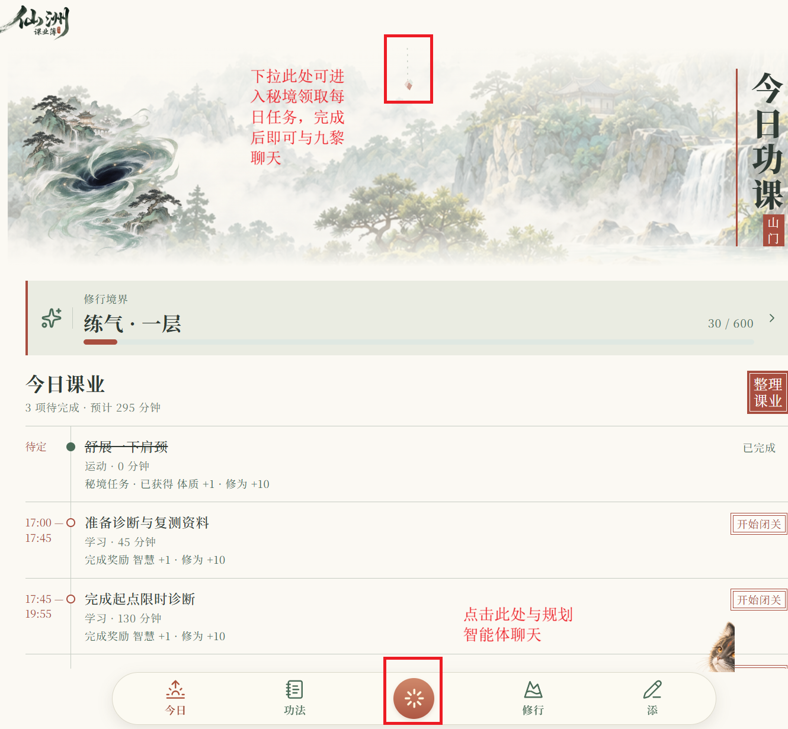

仙洲课业簿主页：<https://simucultivation.online/>

# 仙洲课业簿快速上手

打开[网页版主页](https://simucultivation.online/latest/)，点左上角人物入口，选择「登录」。首次使用请点「注册新账号」，按提示设置账号和密码；已有账号可直接[登录](https://simucultivation.online/latest/login)。

## 和灵宠九黎聊天

1. 点「今日」并回到页首，找到**图中上方红框里的红绳**。在手机上按住绳尾的小吊坠，向下拉一截再松手；在电脑上直接点击吊坠，即可进入「今日限时秘境」。
2. 进入秘境后，记下今天掉落的任务。如果页面显示「开启今日秘境」，先点它领取任务。回到「今日」，完成这项任务并将它标记为已完成，即可领取九黎。
3. 打开[灵宠空间](https://simucultivation.online/latest/pet-space)，按提示领取九黎，点「陪伴会话」即可开始聊天。以后在「今日」看到屏幕右侧的灵宠时，向左滑出九黎，再点一下它就能聊天。

## 请规划助手安排学习

1. 点**图中底部红框里的橙色圆钮**（在「功法」和「修行」之间），进入[金手指·规划agent](https://simucultivation.online/latest/planner)，选择「探索新功法」。
2. 想先看各阶段学什么，选「粗略规划」；想把学习排到具体日期，选「精确规划」，并选好当前基础和可投入时段。
3. 输入目标并发送，例如“未来两周想复习英语六级，重点练听力”。收到满意的方案后点确认采用，再到「功法」查看。

想了解九黎的对话机制和代码结构，可阅读[九黎 C0 介绍](九黎C0介绍.md)。
